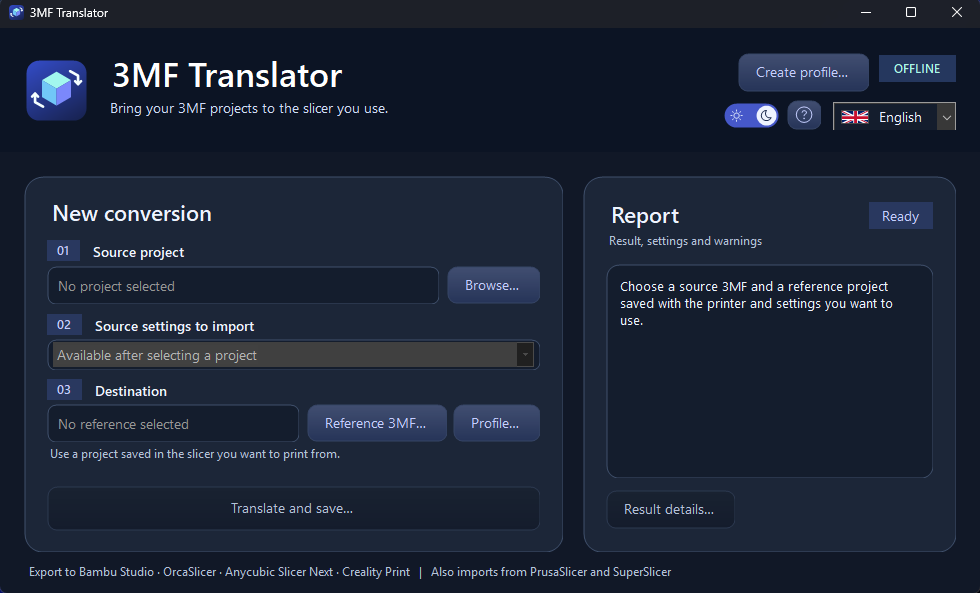
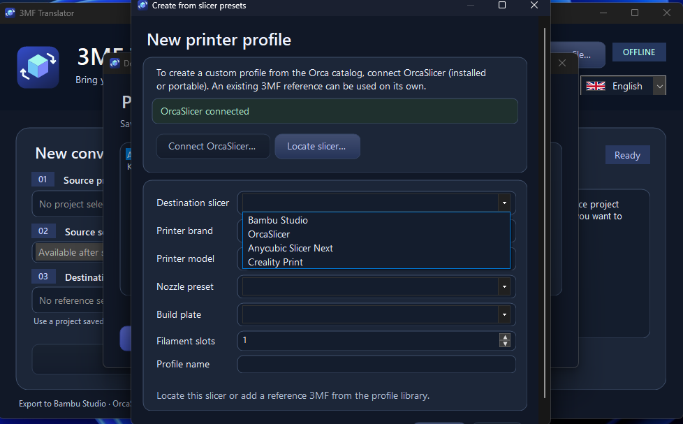
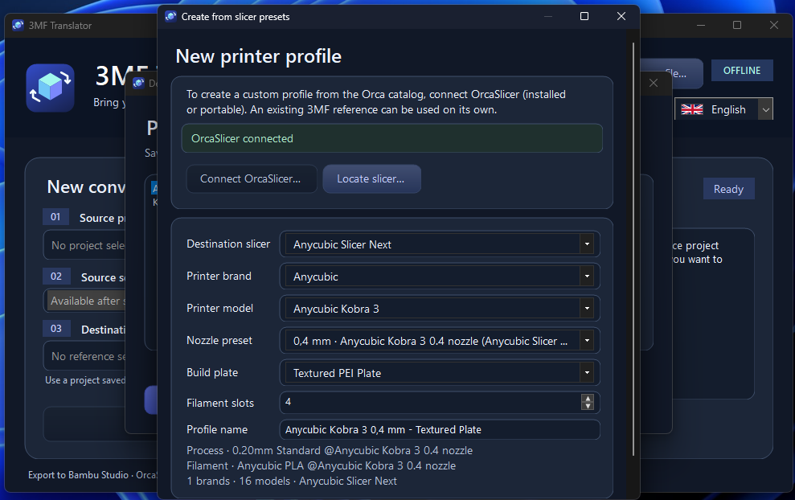
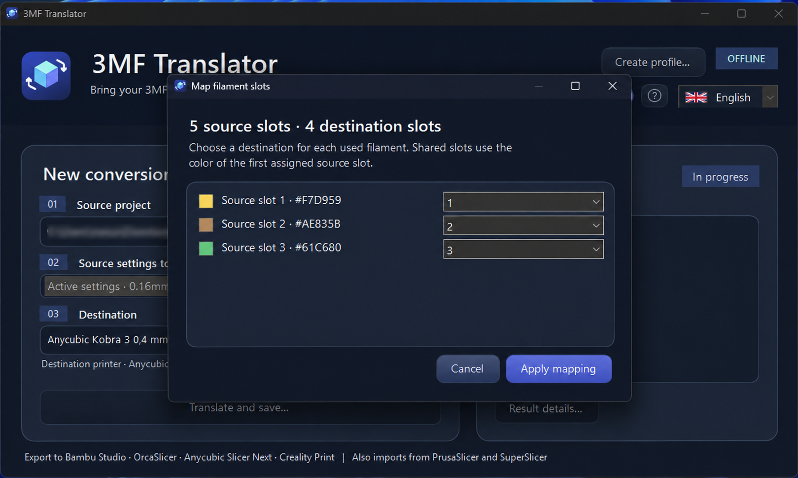
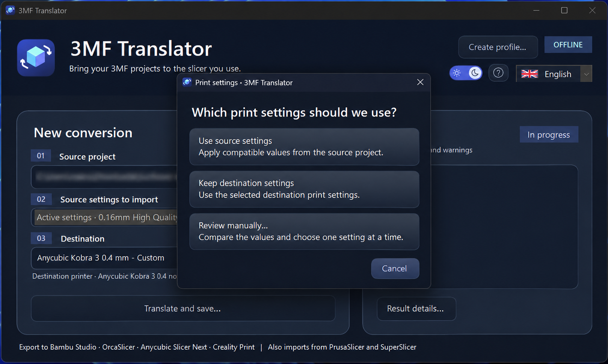
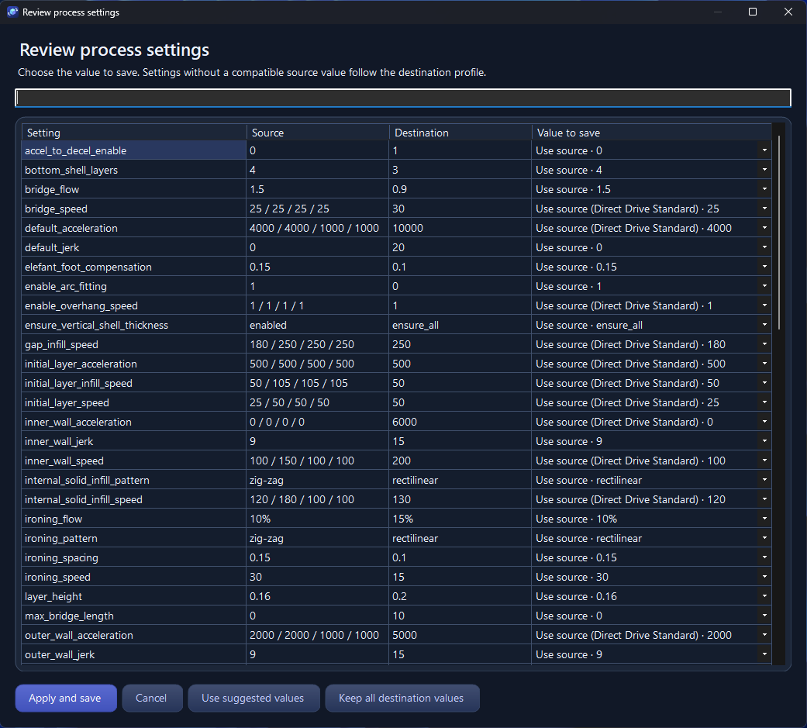
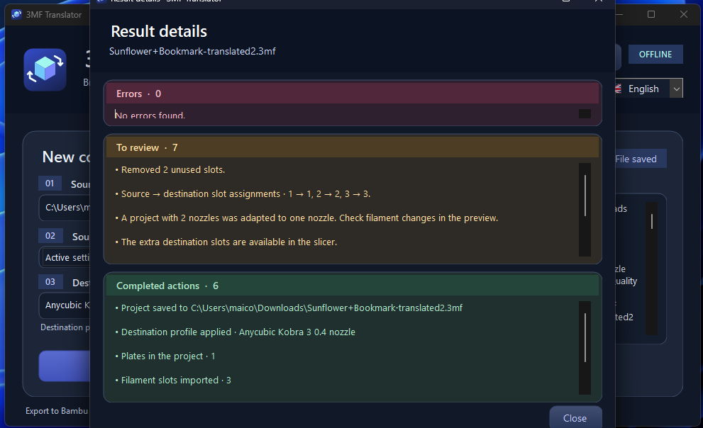

# 3mfSlicerTranslator - Convert 3MF Files Between Bambu Studio, OrcaSlicer, Anycubic Slicer Next and Creality Print

A Windows app for translating and managing 3MF projects between compatible slicers.

[Read the user guide](USER_GUIDE.txt)

## Features

- Convert 3MF projects for Bambu Studio, OrcaSlicer, Anycubic Slicer Next, and Creality Print. Import projects saved by these slicers, plus compatible projects from PrusaSlicer 2.x and SuperSlicer.
- Transfer model geometry and compatible print settings, with the option to review and choose individual values.
- Choose a destination slicer before browsing printer models. Create reusable profiles from compatible presets in OrcaSlicer, Bambu Studio, or Anycubic Slicer Next, or from a 3MF saved in the destination slicer.
- Use the OrcaSlicer catalog to find additional Bambu Lab and Creality models. For Creality Print and for Bambu models without a native preset, save a reference 3MF in the destination slicer.
- Choose a compatible nozzle, build plate, and filament slot count. Smooth and textured PEI plate presets are available when supported by the printer profile.
- Save profiles for reuse without keeping the slicer that supplied the presets installed.
- Review transferred settings, filament slot mappings, and conversion warnings.
- Use the desktop app, or convert projects from the command line.

## Showcase

### Main application window

Convert compatible 3MF printing projects between Bambu Studio, OrcaSlicer, Anycubic Slicer Next, and Creality Print.

## How it works

### 1. Create a destination printer profile

Create a reusable profile from supported slicer presets or use a reference 3MF project saved in the destination slicer.

### 2. Configure the printer

Choose the destination slicer, printer model, nozzle preset, build plate, and filament slot count where supported.

### 3. Load a project and map filaments

Select the source 3MF and destination profile. When necessary, review filament slot assignments.

### 4. Choose print settings

Use compatible source settings, keep destination settings, or review settings manually.

### 5. Review individual settings

Compare source and destination settings and choose which compatible values to save.

### 6. Check the conversion report

Inspect errors, warnings, and completed actions. Open the resulting 3MF in the destination slicer and verify the sliced preview.

For complete instructions, see the [User Guide](USER_GUIDE.txt).
  
